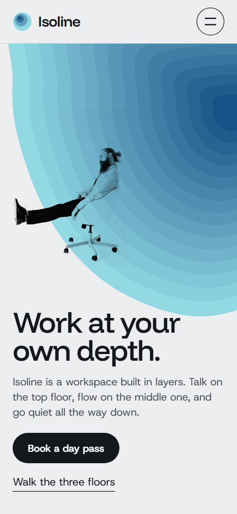
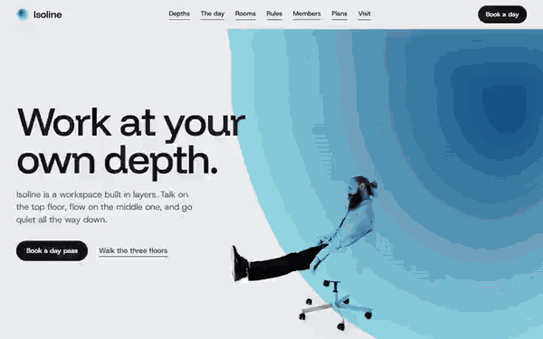

# Free HTML coworking website template with GSAP scroll animations — Isoline

**Website for a coworking space or members' workspace, with day passes and memberships: a free HTML template in one file, with GSAP scroll animations, no build step, MIT license. Made by [8B](https://8b.com/), the AI website builder.**

[](LICENSE)  

**[Live demo](https://8bsite.github.io/coworking-website-template/)** · **[Use this template](https://github.com/new?template_name=coworking-website-template&template_owner=8bsite)** · **[Download ZIP](https://github.com/8bsite/coworking-website-template/archive/refs/heads/main.zip)** · **[Template page on 8b.com](https://8b.com/templates/isoline/)**

<a href="https://8bsite.github.io/coworking-website-template/"></a> <a href="https://8bsite.github.io/coworking-website-template/"></a>

<p align="center"><a href="https://8bsite.github.io/coworking-website-template/"></a><br><sub>Scroll animation</sub></p>

A one-page site for an invented members' workspace in Leeds with three floors, from a talkative roof down to silent study carrels. Big colour fields of nested stepped bands, like contour lines, mark each floor's depth in orange, blue and violet; on the first scroll you fall into the blue field, prints drop on their wires and the bands fill and open as you read on.

Good for: coworking space or shared office; quiet study space, library or writers' room; members' club with day passes and memberships; any venue with floors, zones or levels to explain.

## Use it with an AI coding agent

Download the files into your project (in Windows PowerShell type `curl.exe`):

```bash
curl -LO https://raw.githubusercontent.com/8bsite/coworking-website-template/main/index.html
curl -LO https://raw.githubusercontent.com/8bsite/coworking-website-template/main/AGENTS.md
curl -LO https://raw.githubusercontent.com/8bsite/coworking-website-template/main/LICENSE
curl -LO https://raw.githubusercontent.com/8bsite/coworking-website-template/main/CREDITS.md
```

Then give your agent this prompt:

```text
Read AGENTS.md, then edit index.html. Use this template as the base for a site for <your coworking space or workspace: name, city, floors or zones, opening hours, prices, events, how to book>. Keep the layout, the motion and the single-file format; replace the brand name, copy, photos, prices, dates, member names, links and contacts, and recolour it through the CSS variables if needed.
```

Give the agent the downloaded file, not a link: from a link it would rebuild a different page. No agent? Click **[Use this template](https://github.com/new?template_name=coworking-website-template&template_owner=8bsite)**, edit `index.html` and turn on **Settings → Pages**.

## What's on the page

- **Navigation** — top bar: wordmark, section links, Book a day button; phone menu overlay
- **Work at your own depth.** — two screens: headline over a huge colour field with a figure on its edge, then a statement and three anchors on the field's colour
- **Three depths. Pick one each morning.** — three hanging posters, one per zone or level, each with its own colour field, photo and caption (demo: the three floors)
- **The building has a day of its own.** — daily schedule beside a sticky colour dial (demo: a weekday from 7:30 to 21:00)
- **Rooms, in order of descent.** — list of rooms indented by level, each with a small hanging photo
- **Three rules, posted at the stairs.** — three short house rules inside a V-shaped cross-section of bands
- **Who works down here.** — four members with photo, name, job and a quote, each under a small colour field
- **Surfacing, on Thursday evenings.** — list of upcoming events with date, time, title, speaker, place and a Save a seat link (demo: Thursday talks)
- **Finished at depth.** — table of works members finished, each with a small stepped colour swatch
- **How deep a membership goes.** — three pricing plans as colour fields whose band count shows how much each includes
- **Come down for a day.** — contact: address, hours, phone, email, a drawn contour map and a tour request form (placeholders)
- **Footer** — tagline with address, links, wordmark, copyright and the Design: 8B credit, hours line

## Design

Palette:             
Fonts: Funnel Display, Host Grotesk (Google Fonts). Change both through the CSS variables in the `:root` block at the top of `<head>`. A big display line with `style="--len:N"` fills its width: set N to its new number of characters.

- The colour fields, posters, dial, rules well and contour map are SVG and CSS, not images: the three depth colours (orange, blue, violet) come from the :root colour variables, so recolour them there.
- Person photos are printed with multiply onto the fields: use photos on a white or very light ground, or the background will show as a box.

## Before you publish

- Replace everything marked `data-8b-placeholder` (social preview image, favicon, phone, email, form) and the invented demo facts: prices, dates, address. [AGENTS.md](AGENTS.md) lists them.
- The form sends nothing yet: connect it to Formspree or Netlify Forms, or remove it.

## Tech

GSAP 3.13.0, ScrollTrigger, SplitText, Lenis 1.3.27 from jsDelivr, 153 KB, no build step. Chrome and Edge 111+, Safari 16.2+, Firefox 113+ (it uses color-mix(), cascade layers). With "reduce motion" on, the page is complete and still.

## License

MIT, see [LICENSE](LICENSE); the "Design: 8B" footer link is welcome, not required. Photos, fonts and libraries keep their own licences: [CREDITS.md](CREDITS.md). More free templates: [8b.com/templates](https://8b.com/templates/) · [github.com/8bsite](https://github.com/8bsite).
